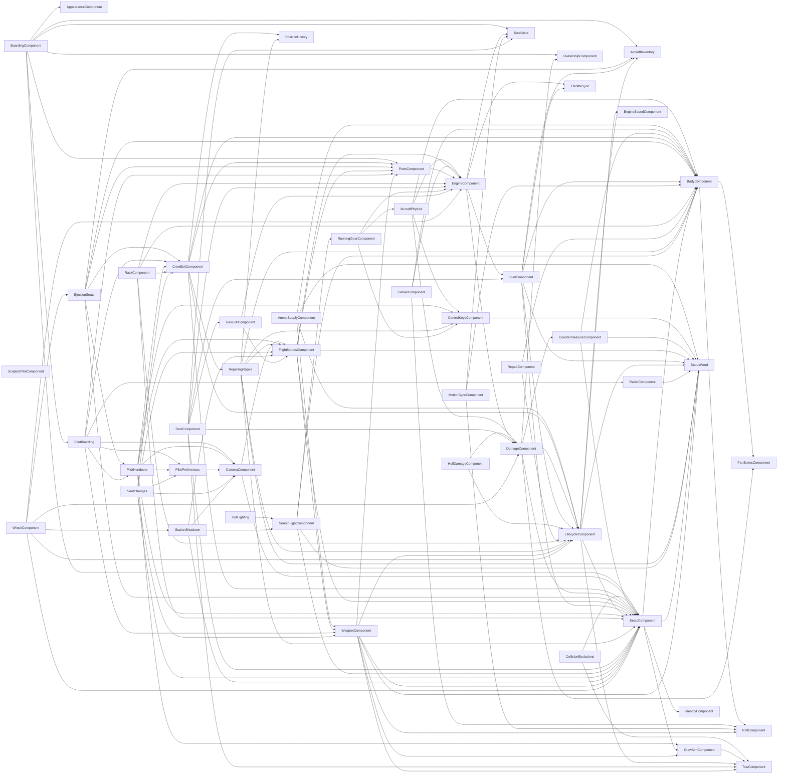
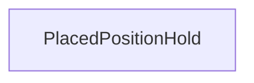
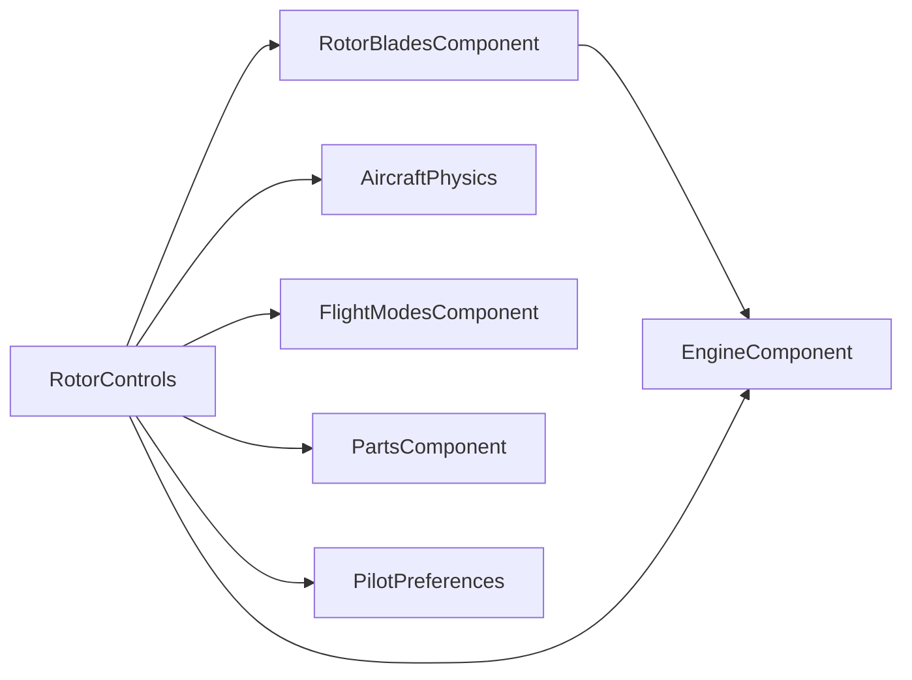
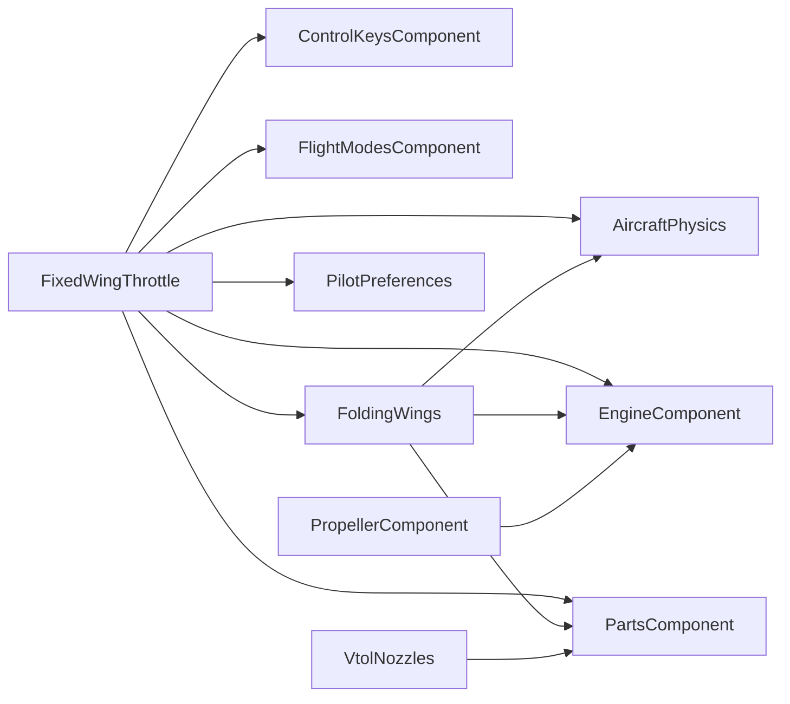
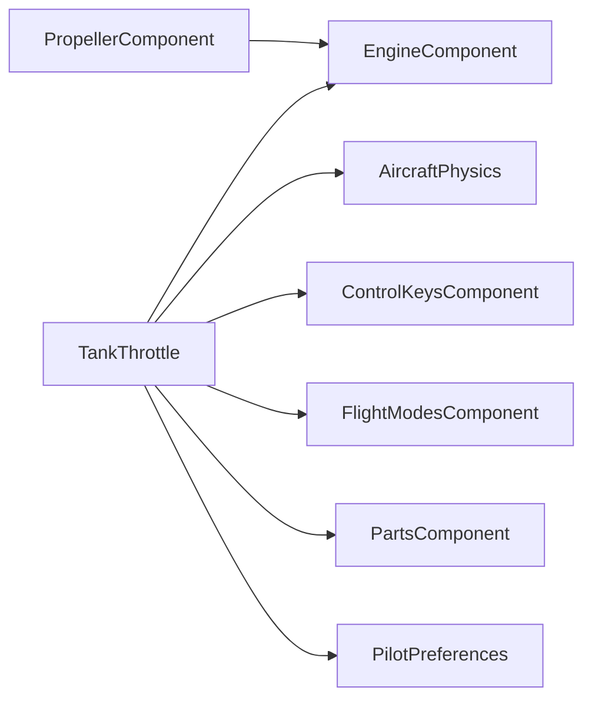

# Vehicle components

<!-- Generated from the compiled classes by `./gradlew :architecture:writeComponentGraph`; do not edit.
     ComponentRulesTest fails while this file is stale. -->

Every vehicle is made of components (`VehicleComponent`). A component gets the components it works
with through its constructor, so its constructor parameters are its dependencies: an arrow points
from a component to one it depends on. `AircraftComponents` builds the components every vehicle
shares in that order, and each vehicle kind's entity builds its own on top of them. The graph has no
cycles; the architecture tests check that, and that nothing reaches a component through the vehicle
entity instead (see [ARCHITECTURE_RULES.md](ARCHITECTURE_RULES.md)).

A component with a tick of its own declares the phase it ticks in and the components it must tick
after (`@TickOrder`). Every component named there is one it depends on; the tick pipeline checks the
order when it is built. [ARCHITECTURE.md](ARCHITECTURE.md) Part 1 §2.4 and §2.6 describe the model.

*Fan-in* counts the components of the vehicle that depend on a component. *Fan-out* counts the
collaborators its constructor takes: other components and narrow ports, not the host entity,
plain values or settings. A constructor takes at most 7 (see
[ARCHITECTURE_RULES.md](ARCHITECTURE_RULES.md), "Components").

## Every vehicle

The components `AircraftComponents` builds, which every vehicle kind has.

| Component | Ticks in | Ticks after | Fan-in | Fan-out | Depends on |
|---|---|---|---|---|---|
| `AircraftInventory` | - | - | 4 | 0 | - |
| `AircraftPhysics` | - | - | 1 | 4 | BodyComponent, ControlKeysComponent, DamageComponent, EngineComponent |
| `AmmoSupplyComponent` | SYSTEMS | - | 0 | 4 | BodyComponent, LifecycleComponent, StatusWord, WeaponComponent |
| `AppearanceComponent` | - | - | 1 | 0 | - |
| `BoardingComponent` | - | - | 0 | 7 | AircraftInventory, AppearanceComponent, OwnershipComponent, PartsComponent, PilotBoarding, RestState, SeatsComponent |
| `BodyComponent` | - | - | 13 | 2 | PartBoxesComponent, RollComponent |
| `CameraComponent` | - | - | 5 | 3 | FlightModesComponent, SeatsComponent |
| `CarrierComponent` | LIFECYCLE | - | 0 | 3 | BodyComponent, EngineComponent, RollComponent |
| `CollisionExclusions` | SYSTEMS | - | 0 | 2 | SeatsComponent, TowComponent |
| `ControlKeysComponent` | - | - | 4 | 1 | StatusWord |
| `CountermeasureComponent` | SYSTEMS | - | 1 | 3 | BodyComponent, SeatsComponent, StatusWord |
| `CrewAimComponent` | - | - | 3 | 1 | TowComponent |
| `CrewExitComponent` | FOLLOW_HULL | PartsComponent | 5 | 6 | BodyComponent, LifecycleComponent, PartsComponent, PositionHistory, RepellingRopes, SeatsComponent |
| `DamageComponent` | SYSTEMS | - | 5 | 5 | CountermeasureComponent, LifecycleComponent, OwnershipComponent, PartBoxesComponent, SeatsComponent |
| `EjectionSeats` | - | - | 1 | 6 | AircraftInventory, BodyComponent, CrewExitComponent, PartsComponent, PilotHandover, SeatsComponent |
| `EngineComponent` | - | - | 9 | 4 | DamageComponent, FuelComponent, RestState, ThrottleSync |
| `EngineSoundComponent` | - | - | 1 | 2 | - |
| `FlightModesComponent` | - | - | 6 | 6 | EngineComponent, PartsComponent, SeatsComponent, StatusWord, WeaponComponent |
| `FuelComponent` | SYSTEMS | - | 2 | 6 | AircraftInventory, BodyComponent, LifecycleComponent, SeatsComponent, StatusWord, ThrottleSync |
| `HullDamageComponent` | FOLLOW_HULL | DamageComponent | 0 | 2 | DamageComponent, LifecycleComponent |
| `HullLighting` | - | - | 0 | 1 | SearchLightComponent |
| `IdentityComponent` | - | - | 1 | 0 | - |
| `LifecycleComponent` | - | - | 10 | 5 | AircraftInventory, EngineSoundComponent, SeatsComponent, StatusWord, TowComponent |
| `MotionSyncComponent` | - | - | 0 | 3 | BodyComponent, RestState, RollComponent |
| `OwnershipComponent` | - | - | 2 | 0 | - |
| `PartBoxesComponent` | FOLLOW_HULL | - | 2 | 0 | - |
| `PartsComponent` | FOLLOW_HULL | - | 6 | 1 | EngineComponent |
| `PilotBoarding` | - | - | 1 | 7 | CameraComponent, CrewExitComponent, PartsComponent, PilotHandover, PilotPreferences, RadarComponent, WeaponComponent |
| `PilotHandover` | - | - | 2 | 7 | CameraComponent, ControlKeysComponent, CrewAimComponent, CrewExitComponent, FlightModesComponent, PilotPreferences, SeatsComponent |
| `PilotPreferences` | - | - | 3 | 1 | CameraComponent |
| `PositionHistory` | - | - | 2 | 0 | - |
| `RackComponent` | - | - | 0 | 5 | BodyComponent, CrewExitComponent, EngineComponent, LifecycleComponent, SeatsComponent |
| `RadarComponent` | - | - | 1 | 1 | StatusWord |
| `RepairComponent` | SYSTEMS | - | 0 | 2 | BodyComponent, LifecycleComponent |
| `RepellingRopes` | FOLLOW_HULL | - | 1 | 7 | BodyComponent, ControlKeysComponent, FlightModesComponent, LifecycleComponent, PositionHistory, SeatsComponent, StatusWord |
| `RestComponent` | - | - | 0 | 7 | DamageComponent, EngineComponent, FuelComponent, RestState, SeatsComponent, TowComponent, UavLinkComponent |
| `RestState` | - | - | 4 | 0 | - |
| `RollComponent` | - | - | 4 | 0 | - |
| `RunningGearComponent` | - | - | 1 | 3 | AircraftPhysics, ControlKeysComponent, EngineComponent |
| `ScriptedPilotComponent` | - | - | 0 | 0 | - |
| `SearchLightComponent` | - | - | 2 | 4 | BodyComponent, RunningGearComponent, SeatsComponent, StatusWord |
| `SeatChanges` | - | - | 0 | 6 | CameraComponent, CrewExitComponent, FlightModesComponent, PilotPreferences, SeatsComponent, WeaponComponent |
| `SeatsComponent` | PHYSICS | - | 19 | 4 | BodyComponent, CrewAimComponent, IdentityComponent, StatusWord |
| `StationShutdown` | - | - | 1 | 4 | CameraComponent, FlightModesComponent, SearchLightComponent, SeatsComponent |
| `StatusWord` | - | - | 11 | 0 | - |
| `ThrottleSync` | - | - | 2 | 0 | - |
| `TowComponent` | - | - | 5 | 0 | - |
| `UavLinkComponent` | SYSTEMS | - | 1 | 2 | EngineComponent, FlightModesComponent |
| `WeaponComponent` | PHYSICS | - | 4 | 7 | CrewAimComponent, LifecycleComponent, PartsComponent, RollComponent, SeatsComponent, StatusWord, TowComponent |
| `WreckComponent` | LIFECYCLE | - | 0 | 6 | DamageComponent, EjectionSeats, EngineComponent, LifecycleComponent, SeatsComponent, StationShutdown |

## Ground vehicle

What a ground vehicle adds to the components every vehicle has.

| Component | Ticks in | Ticks after | Fan-in | Fan-out | Depends on |
|---|---|---|---|---|---|
| `PlacedPositionHold` | PHYSICS | - | 0 | 0 | - |

## Helicopter

What a helicopter adds to the components every vehicle has.

| Component | Ticks in | Ticks after | Fan-in | Fan-out | Depends on |
|---|---|---|---|---|---|
| `RotorBladesComponent` | PHYSICS | - | 1 | 1 | EngineComponent |
| `RotorControls` | PHYSICS | - | 0 | 6 | AircraftPhysics, EngineComponent, FlightModesComponent, PartsComponent, PilotPreferences, RotorBladesComponent |

## Plane

What a plane adds to the components every vehicle has.

| Component | Ticks in | Ticks after | Fan-in | Fan-out | Depends on |
|---|---|---|---|---|---|
| `FixedWingThrottle` | PHYSICS | - | 0 | 7 | AircraftPhysics, ControlKeysComponent, EngineComponent, FlightModesComponent, FoldingWings, PartsComponent, PilotPreferences |
| `FoldingWings` | - | - | 1 | 3 | AircraftPhysics, EngineComponent, PartsComponent |
| `PropellerComponent` | PHYSICS | - | 0 | 1 | EngineComponent |
| `VtolNozzles` | - | - | 0 | 1 | PartsComponent |

## Ship

What a ship adds to the components every vehicle has.

| Component | Ticks in | Ticks after | Fan-in | Fan-out | Depends on |
|---|---|---|---|---|---|
| `FixedWingThrottle` | PHYSICS | - | 0 | 7 | AircraftPhysics, ControlKeysComponent, EngineComponent, FlightModesComponent, FoldingWings, PartsComponent, PilotPreferences |
| `FoldingWings` | - | - | 1 | 3 | AircraftPhysics, EngineComponent, PartsComponent |
| `PropellerComponent` | PHYSICS | - | 0 | 1 | EngineComponent |
| `VtolNozzles` | - | - | 0 | 1 | PartsComponent |

## Tank

What a tank adds to the components every vehicle has.

| Component | Ticks in | Ticks after | Fan-in | Fan-out | Depends on |
|---|---|---|---|---|---|
| `PropellerComponent` | PHYSICS | - | 0 | 1 | EngineComponent |
| `TankThrottle` | PHYSICS | - | 0 | 6 | AircraftPhysics, ControlKeysComponent, EngineComponent, FlightModesComponent, PartsComponent, PilotPreferences |

